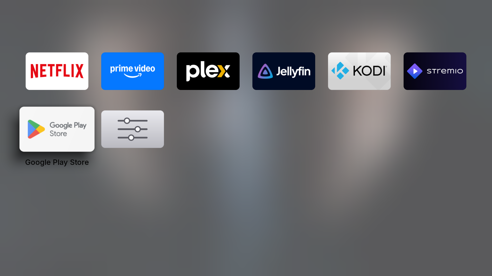
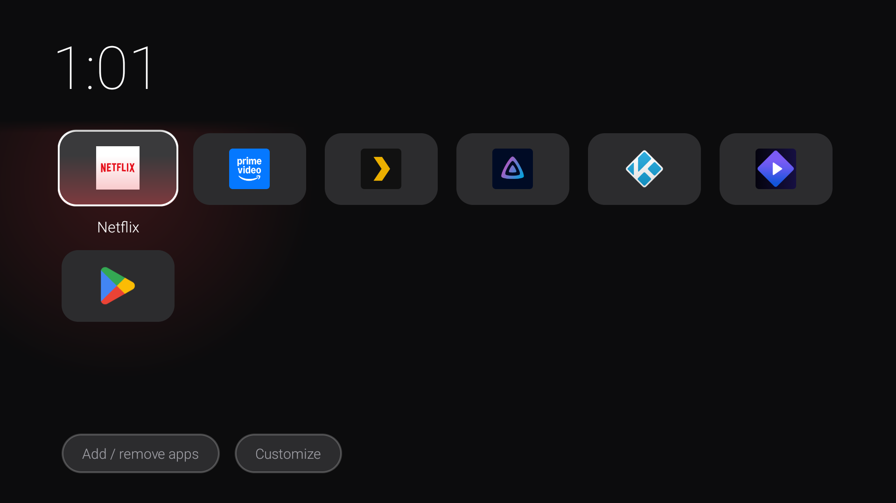
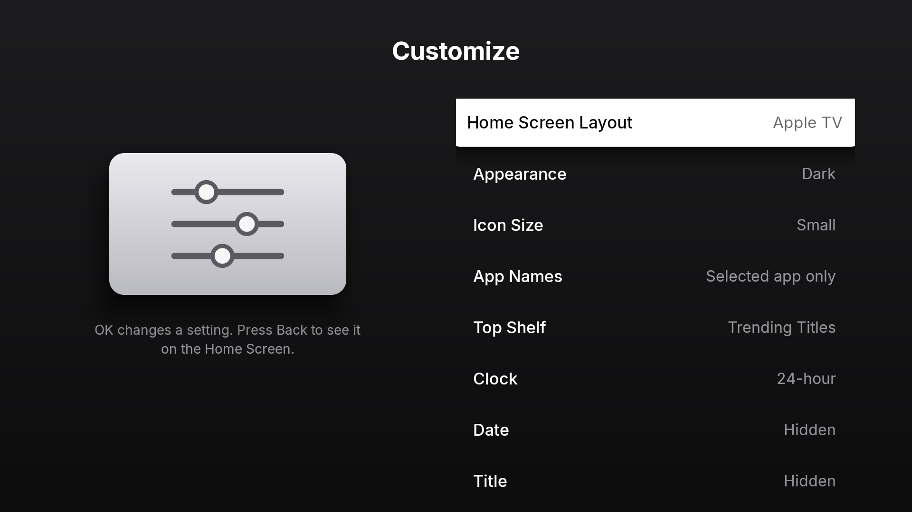

# Lean TV Home

A small, fast home screen (launcher) for Android TV and Google TV boxes. It was made and tested
on an Amlogic S905X4 box (4 GB RAM, Android 14, Google TV; see
[Tested on](#tested-on)). It should work on any Android TV device running Android 8.0 or newer.

On that box it uses **60 to 85 MB of memory instead of 200 MB** for the stock Google TV home screen,
or 40 MB with the lighter Classic layout. While you watch something it lets go of its pictures and
drops to about 40 to 60 MB.

Google TV's own home screen keeps rows of recommendations, trailers and ads in memory. On a box
with 2–4 GB of RAM that makes everything slower. Lean TV Home only shows the apps you choose,
so the box has more memory left for the app you are actually watching.

The home screen is laid out like the Apple TV home screen of tvOS 26: the selected app's Top Shelf
fills the whole screen behind a glass Dock with the first row of apps, the other rows sit below on
a blurred copy of the same picture, and the clock floats in a small glass pill. App icons are wide
rounded cards that lift and shine when selected, scrolling is springy and apps zoom open out of
their icon. A lighter **Classic** layout is one setting away for slow boxes.


| Apple TV layout, Light | Classic layout |
|---|---|
|  |  |

Press Up from the Dock to open the Top Shelf. As on tvOS, it pages through trending films and
shows with their title logo, and OK opens the app:




## Features

- A grid of your favourite apps under a Top Shelf, a clock and the date. Nothing else runs in the
  background.
- Motion modelled on tvOS: spring-based focus and scrolling, a small tilt and sheen on the
  selected icon, a bump at the edges, and apps that zoom open out of their icon.
- **Add or Remove Apps**, and move apps with the remote (**Rearrange Apps**, or hold OK on an icon and choose **Move**).
- **Apps** folder with everything else that is installed.
- **Customize** screen: layout, appearance, icon size, app names, Top Shelf, clock, date, title,
  motion and which icons show after your apps (see [Customize](#customize)).
- Two layouts: **Apple TV** (the default) and **Classic**, the lighter look of version 1.3.
- Optional **Wake-on-LAN**: turn the box (and the TV, through HDMI-CEC) on from your phone or
  computer, even when the box firmware has no Wake-on-LAN (see [Wake-on-LAN](#wake-on-lan)).
- One button to go back to the Google TV home screen, and one tile to come back.
- No Google Play Services, no ads, no tracking. The APK is about 380 KB, most of it the Inter font.
- The Top Shelf titles come from public Stremio catalogs (Cinemeta, Streaming Catalogs, Kitsu)
  and are cached on the box, so the shelf still works offline. Set **Top Shelf** to **App Colours**
  if you want the home screen to make no network requests at all.

## Tested on

Lean TV Home is built and tested on this box. Every step in this README was run on it.

| | Test box |
|---|---|
| Model | SDMC G1 (device YEG), a generic S905X4 box sold under several brand names |
| Chip | Amlogic S905X4: 4 × Arm Cortex-A55 up to 2.0 GHz, Mali-G31 MP2 GPU |
| RAM | 4 GB (3.6 GB usable by Android) |
| Storage | 32 GB (25 GB for apps and data) |
| System | Android 14 (API 34), Google TV, firmware build 20250313, 32-bit apps |
| Screen | 4K output, user interface at 1920 × 1080, 320 dpi |
| Network | Ethernet (used for the Wake-on-LAN tests) |
| Stock home screen | Google TV home, `com.google.android.tvlauncher` |

Tested: install with `scripts/install.sh`, the Home button, the Customize settings,
Add or Remove Apps, switching to Google TV home and back, and Wake-on-LAN from
standby over Ethernet.

### Memory: Lean TV Home compared with the stock home screen

Measured on the box above (Google TV home on 2026-10-25, Lean TV Home 2.1 on 2026-10-29), each
home screen on screen and idle after moving through the icons, with the same
apps installed. "Memory used" is the PSS from `adb shell dumpsys meminfo <package>`: the memory
the app really uses, with shared memory split fairly between apps.

| | Google TV home (stock) | Lean TV Home, Apple TV layout | Lean TV Home, Classic layout |
|---|---|---|---|
| Memory used by the home screen app (PSS) | 200 MB | **61 to 86 MB** | **40 MB** |
| The same, while another app is on screen | about 200 MB | **41 to 63 MB** | about 40 MB |
| Resident memory (RSS) | 331 MB | 197 MB | 149 MB |
| APK size | (system app) | about 380 KB | the same app |

Wake-on-LAN was on for both Lean TV Home readings. The Apple TV layout uses more memory because it
keeps the full-screen Top Shelf pictures ready for the apps in the Dock. When an app opens, the
home screen drops these pictures and gets them back from its disk cache in about 0.3 seconds
when you return.

When you leave Google TV home turned off, it never starts again, so that memory stays free while
you watch something too.

## Installation

You need:

- The TV box, connected to the same network as a computer.
- A computer with **adb** (Android platform tools). Download it from
  <https://developer.android.com/tools/releases/platform-tools>, unzip it, and open a terminal in
  that folder. On macOS you can also run `brew install android-platform-tools`; on Debian or
  Ubuntu, `sudo apt install adb`.
- The latest `lean-tv-home-x.y.z.apk` from the
  [Releases](https://github.com/tranmani/lean-tv-home/releases) page.

Why a computer? Google TV hides the **Disable** button for its own home screen, and while that
app is on it always takes the Home button, even after you choose another home app. Only adb can
turn it off. You only need the computer once.

### Step 1. Turn on developer options on the box

1. On the box, open **Settings → System → About**.
2. Select **Android TV OS build** and press OK on the remote **7 times**. A message says
   "You are now a developer".
3. Go back to **Settings → System**. A new **Developer options** entry is there.

### Step 2. Turn on debugging

1. Open **Settings → System → Developer options**.
2. Turn on **USB debugging**.
3. If the list also has **Network debugging** (or **ADB over network**), turn it on. The box now
   accepts adb on port 5555.
   If it only has **Wireless debugging**, turn that on instead and open it. It shows an
   IP address and port, and **Pair device with pairing code** shows a code and a second port.
   You need both in step 4.

### Step 3. Find the box's IP address

Open **Settings → Network & Internet**, select your network (Ethernet or Wi-Fi), and note the
**IP address**, for example `192.168.1.50`.

Tip: give the box a fixed IP address (a DHCP reservation) in your router, so the address never
changes. Wake-on-LAN needs this too.

### Step 4. Connect from the computer

With **Network debugging** (port 5555):

```sh
adb connect 192.168.1.50
```

With **Wireless debugging** (use the ports shown on the TV):

```sh
adb pair 192.168.1.50:PAIRING_PORT      # type the pairing code when asked
adb connect 192.168.1.50:PORT
```

The TV may show **Allow debugging?** Select **Always allow from this computer**, then OK.
Check the connection:

```sh
adb devices        # the box must show as "device", not "unauthorized"
```

### Step 5. Install and make it the Home app

**Quick way (macOS / Linux):** clone this repository or download the `scripts` folder, then run:

```sh
scripts/install.sh 192.168.1.50 lean-tv-home-2.1.1.apk
```

(With Wireless debugging, pass `192.168.1.50:PORT` instead of the bare IP address.)

The script installs the APK, makes Lean TV Home the Home app, turns off the Google TV home
screen, allows Wake-on-LAN to turn the screen on, and presses Home.

**Step by step (any computer, also Windows):** run these commands one by one. Replace the IP
address and the file name with yours.

```sh
adb connect 192.168.1.50

# 1. Install
adb install -r lean-tv-home-2.1.1.apk

# 2. Make Lean TV Home the Home app
adb shell cmd role add-role-holder android.app.role.HOME org.lean.tvhome
adb shell cmd package set-home-activity --user 0 org.lean.tvhome/.HomeEntry

# 3. Turn off the default home screen, so the Home button opens Lean TV Home
adb shell pm disable-user --user 0 com.google.android.tvlauncher

# 4. Optional, only for Wake-on-LAN
adb shell appops set org.lean.tvhome TURN_SCREEN_ON allow
adb shell dumpsys deviceidle whitelist +org.lean.tvhome

# 5. Test
adb shell input keyevent KEYCODE_HOME
```

Notes:

- Step 3 is the step that makes the **Home button** open Lean TV Home. Without it, Google TV
  keeps taking the Home button.
- `disable-user` does not uninstall anything and does not need root. Google TV home stays on
  the box, turned off, and you can turn it back on at any time (see
  [Going back to Google TV home](#going-back-to-google-tv-home)).
- On a plain **Android TV** box (not Google TV), the default home is usually
  `com.google.android.leanbacklauncher`. Some boxes have their own launcher. To see every home
  app on your box:

  ```sh
  adb shell cmd package query-activities -a android.intent.action.MAIN -c android.intent.category.HOME
  ```

  Then run step 3 with that package name instead. Do not disable `com.android.tv.settings`
  or any package with "setup" or "provision" in its name: the box needs them.
- A system update can turn Google TV home back on. If the Home button opens Google TV again,
  run step 3 again.

### Step 6. Turn debugging off again (optional)

When everything works, you can turn **USB debugging** and **Network debugging** off again in
Developer options. Lean TV Home keeps working. You need them again only to change the settings
that need adb (Wake-on-LAN screen access, the MAC filter, going back to Google TV home with the
script).

### Without a computer

You can install the APK without a computer, for example with the **Downloader** app or
**Send files to TV**. Then open **Lean TV Home** from the app list and select **Set as default**.

But Google TV still keeps the Home button while its own home screen is on. To turn it off without
a computer, use an adb app on an Android phone on the same network (search the Play Store for
"adb shell" or "Bugjaeger"), connect it to the box as in step 4, and run the commands from step 5,
part 3. Lean TV Home shows these commands too: **Customize → Turn Google TV Home Off**.

## Using it

| On the home screen | What it does |
|---|---|
| Arrow keys and OK | Move between icons and open an app. The apps in the Dock (the first row) fill the Top Shelf. |
| Up from the Dock | Opens the Top Shelf. Left and Right page through its titles; OK opens the app; Down goes back. |
| Hold OK on an icon, or press Menu | Menu: Move, Remove from Home Screen, App Info, Customize Home Screen. |
| **Move** | The icon wiggles. Move it with the arrow keys, then press OK (Back cancels). |
| Back | Returns to the first row. |
| **Apps** | Every installed app, A to Z. Hold OK on an app to add it to the Home Screen or remove it. |
| **Customize** | Change the look (see below). |
| **Settings** | The box's Android settings. |

### Customize

Open **Customize** on the home screen. OK on a row steps to its next value. Press Back to see the
change on the home screen.

| Setting | Values |
|---|---|
| Home Screen Layout | **Apple TV** (default), Classic. Classic is the lighter layout of version 1.3: a big clock, card tiles with the app icon inside and a row of buttons. |
| Appearance | Dark, Midnight, Black, Forest, Plum, Light |
| Icon Size | Small, Medium, Large (6, 5 or 4 icons per row) |
| App Names | Selected app only, Always, Hidden |
| Top Shelf | **Trending Titles** (default): trending films and shows (the app's own list for Netflix, Prime Video, Disney+, Max and Apple TV, anime for anime apps, and the overall top list for other video apps); App Colours: a backdrop drawn from the app's own icon; Off. Apple TV layout only. |
| Clock | 24-hour, 12-hour, Hidden |
| Date | Hidden, Shown |
| Title | Any text, or hidden (the default). |
| Motion | Full, Reduced (no tilt, wiggle or zoom; smaller lift) |
| Icons After Your Apps | Apps, Customize, Settings; Apps and Customize; Customize only |
| Add or Remove Apps | OK on an app puts it on the Home Screen or takes it off. |
| Wake-on-LAN | On, Off |
| Use Google TV Home Instead | Gives the Home button back to Google TV (see below) |
| Reset the Look | Resets the look. Your apps and their order stay. |

### Setting things from a computer

You can also set the app list, the title and Wake-on-LAN with adb. Each extra is optional:

```sh
# Replace the home screen tiles, in this order (package names, comma separated)
adb shell am start -n org.lean.tvhome/.HomeEntry \
  --es order "com.netflix.ninja,com.google.android.youtube.tv,org.jellyfin.androidtv"

# Wake-on-LAN on, and only for packets addressed to this box
adb shell am start -n org.lean.tvhome/.HomeEntry --ez wol true --es wol_mac aa:bb:cc:dd:ee:ff

# Title at the top of the Home Screen ('' hides it). Quote the whole command: adb splits it again on the box.
adb shell "am start -n org.lean.tvhome/.HomeEntry --es title 'LIVING ROOM'"

# Show an order without saving it (for screenshots); press Home to go back to your own
adb shell am start -n org.lean.tvhome/.HomeEntry --es preview "com.netflix.ninja,org.jellyfin.androidtv"
```

List the package names of the installed apps with `adb shell pm list packages`.

## Wake-on-LAN

Many TV boxes have Wake-on-LAN switched off in their firmware. Lean TV Home can do it in
software: while the screen is off, it keeps the network awake and listens for a standard
Wake-on-LAN "magic packet". When one arrives, it turns the screen on. With HDMI-CEC on, the TV
turns on too.

### Turn it on

1. Connect the box with an **Ethernet cable** if you can. Wi-Fi works only while the box keeps
   Wi-Fi on in standby.
2. On the box, open **Customize → Wake-on-LAN** and turn it on.
3. Android 14 lets an app turn the screen on only after one adb command. Run it once (the
   install script already does):

   ```sh
   adb shell appops set org.lean.tvhome TURN_SCREEN_ON allow
   adb shell dumpsys deviceidle whitelist +org.lean.tvhome
   ```

   **Customize → Wake-on-LAN** shows "On, needs one adb command" until this is done, and
   "On, port 9009" when it is ready.
4. Optional: accept only packets for this box. Find the box's MAC address in
   **Customize → Wake-on-LAN: how to wake this box** or in
   **Settings → Network & Internet → (your network)**, then:

   ```sh
   adb shell am start -n org.lean.tvhome/.HomeEntry --es wol_mac aa:bb:cc:dd:ee:ff
   ```

5. For the TV to turn on with the box, turn on HDMI-CEC in the box settings (usually under
   **Settings → Display & Sound**) and on the TV (LG calls it SIMPLINK, Samsung Anynet+,
   Sony Bravia Sync).

### Wake the box

Send a magic packet to **UDP port 9009**, either to the box's IP address or to your network's
broadcast address (for example `192.168.1.255`). The usual port 9 does not work: Android only
lets system apps use ports below 1024.

- **Phone apps:** any Wake-on-LAN app that lets you set the port, for example "Wake On Lan" by
  Mike Webb (Android) or "Mocha WOL" (iOS). Enter the MAC address, the IP or broadcast address,
  and port 9009.
- **Linux / macOS:** `wakeonlan -i 192.168.1.255 -p 9009 aa:bb:cc:dd:ee:ff`
  (`sudo apt install wakeonlan` or `brew install wakeonlan`).
- **Home Assistant:** the `wake_on_lan.send_magic_packet` action with `port: 9009`.
- **Python, no extra packages:**

  ```python
  import socket
  mac = bytes.fromhex("aa:bb:cc:dd:ee:ff".replace(":", ""))
  s = socket.socket(socket.AF_INET, socket.SOCK_DGRAM)
  s.setsockopt(socket.SOL_SOCKET, socket.SO_BROADCAST, 1)
  s.sendto(b"\xff" * 6 + mac * 16, ("192.168.1.255", 9009))
  ```

### Limits

- The box must be in **standby** (screen off), not unplugged. A box that has no power cannot
  hear anything.
- The box stays out of deep sleep while Wake-on-LAN is on, so it uses a little more power in
  standby. Turn Wake-on-LAN off in Customize if you do not use it.
- It does not work from outside your home network unless your router or VPN forwards the packet.
- After a restart, Wake-on-LAN starts again by itself.

## Going back to Google TV home

**From the box:** open **Customize → Use Google TV Home Instead**. If Google TV home is off, the box opens its **App info** page: select
**Enable**, then press Back. Lean TV Home then gives the Home button back to Google TV.

To come back later, open the **Lean TV Home** tile in Google TV's app list and select
**Set as default**. To turn Google TV home off again, run step 3 of the installation.

**From a computer:**

```sh
scripts/restore-google-home.sh 192.168.1.50              # Home button goes back to Google TV
scripts/restore-google-home.sh 192.168.1.50 --uninstall  # ... and remove Lean TV Home
```

or by hand:

```sh
adb shell pm enable com.google.android.tvlauncher
adb shell cmd role add-role-holder android.app.role.HOME com.google.android.tvlauncher
adb uninstall org.lean.tvhome     # optional
```

If you uninstall Lean TV Home while Google TV home is still off, the box has no home screen and
the Home button does nothing. Run the `pm enable` command above to fix it.

## Troubleshooting

| Problem | Fix |
|---|---|
| The Home button still opens Google TV | Google TV home is still on. Run `adb shell pm disable-user --user 0 com.google.android.tvlauncher`. |
| `adb devices` shows "unauthorized" | Look at the TV and accept **Allow debugging?**. If you missed it, turn USB debugging off and on again. |
| `adb connect` says "connection refused" | Network debugging is off, or the box only offers Wireless debugging. See step 2. |
| `INSTALL_FAILED_UPDATE_INCOMPATIBLE` | A copy signed with another key is installed. Run `adb uninstall org.lean.tvhome`, then install again and repeat step 5. |
| An app is missing from **Add or Remove Apps** | Only apps with a TV launcher entry are listed. Phone-only apps you sideloaded may have none. |
| Animations stutter on a slow box | Open **Customize → Home Screen Layout** and choose **Classic**, or set **Motion** to **Reduced**. |
| Wake-on-LAN does nothing | Check **Customize → Wake-on-LAN** shows "On, port 9009". Send to port 9009, not 9. Check the MAC address. |

## Building from source

There is no Gradle. `build.sh` builds the APK with the Android SDK tools only, in a few seconds.

You need JDK 11 or newer and the Android SDK with **build-tools 35.0.0** and **platform
android-34**:

```sh
sdkmanager "build-tools;35.0.0" "platforms;android-34"
export ANDROID_HOME=~/android-sdk     # your SDK folder
./build.sh 34 2.1.0                   # versionCode, versionName
# output: build/lean-tv-home.apk, signed with ~/.android/debug.keystore
```

To sign with your own key (alias `release`, the password in a file):

```sh
KEYSTORE=~/keys/my-release.jks KEYSTORE_PASS_FILE=~/keys/my-release.pass ./build.sh 34 2.1.0
```

`art/make-art.py` (Python with Pillow) draws the icon and the TV banner in `res/`.

### Code layout

| File | What it does |
|---|---|
| `HomeActivity.java` | The home screen in the Apple TV layout: Top Shelf, icon grid, icon menu. |
| `Classic.java` | The Classic home screen layout (version 1.3). |
| `Grid.java`, `Tile.java` | The icon grid (focus, scrolling, moving icons) and one icon. |
| `Shelf.java` | The Top Shelf: full-screen picture, glass Dock, title logo, clock pill and paging. |
| `Feed.java` | Top Shelf titles: trending lists from public Stremio catalogs and their pictures, cached on disk. |
| `Art.java` | Icon pictures, Top Shelf backdrops and the built-in icons, drawn once and cached. |
| `Motion.java` | Spring curves, the scroll spring, bumps and the move-mode wiggle. |
| `AppsActivity.java` | The Apps folder, and Add or Remove Apps. |
| `CustomizeActivity.java`, `Look.java` | The Customize screen and the saved look. |
| `Ui.java`, `Overlay.java` | The tvOS-style settings list, full-screen alerts and the icon menu. |
| `Apps.java` | Installed apps, the saved icon order, help dialogs. |
| `GoogleHome.java`, `ReturnActivity.java` | Switching the Home button to Google TV and back. |
| `WakeService.java`, `WakeActivity.java` | Wake-on-LAN. |

The interface font is [Inter](https://rsms.me/inter/) (SIL Open Font License, see
[FONT-LICENSE.txt](FONT-LICENSE.txt)), cut down to Latin characters.

## License

MIT. See [LICENSE](LICENSE).
